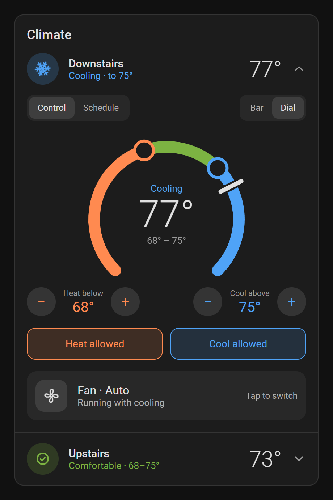
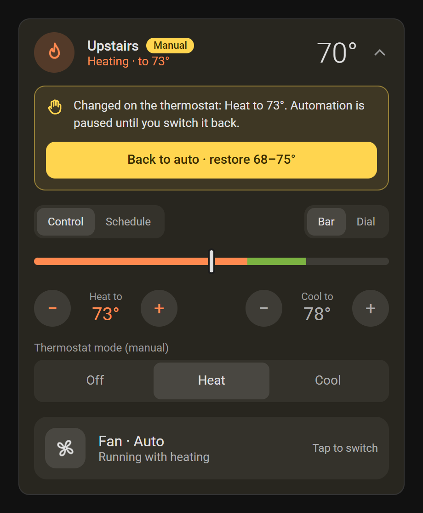
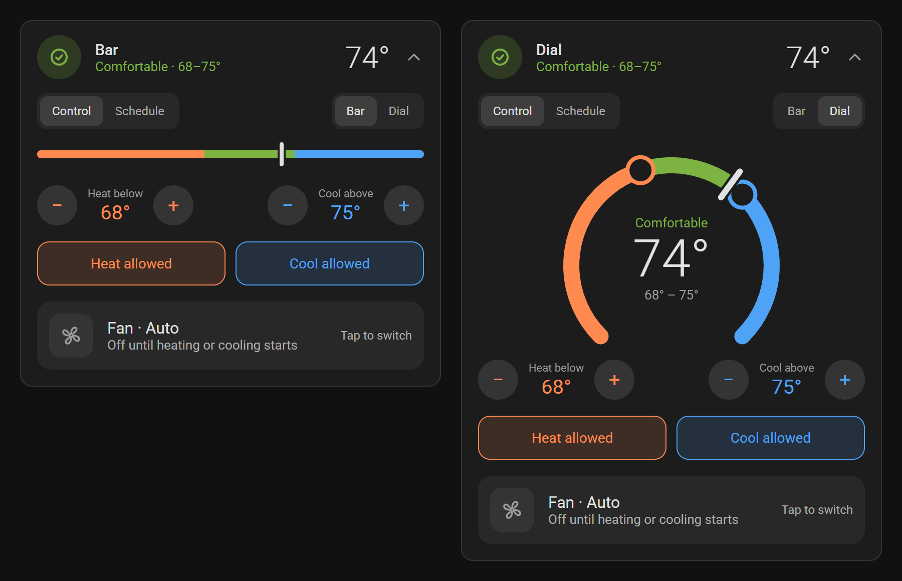
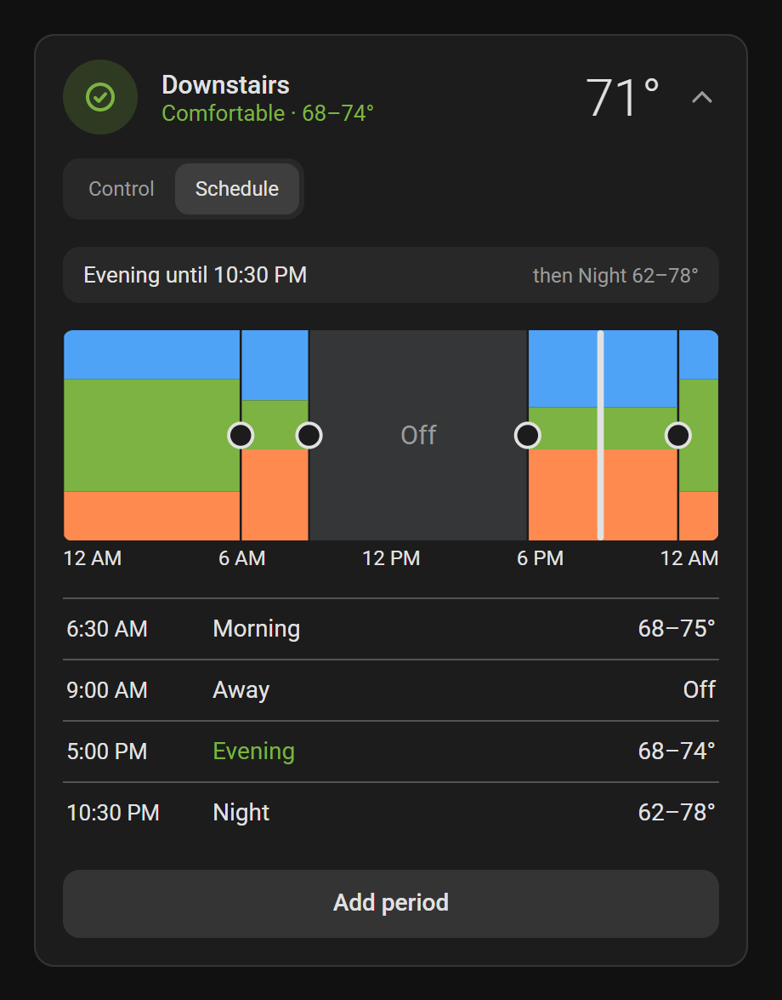
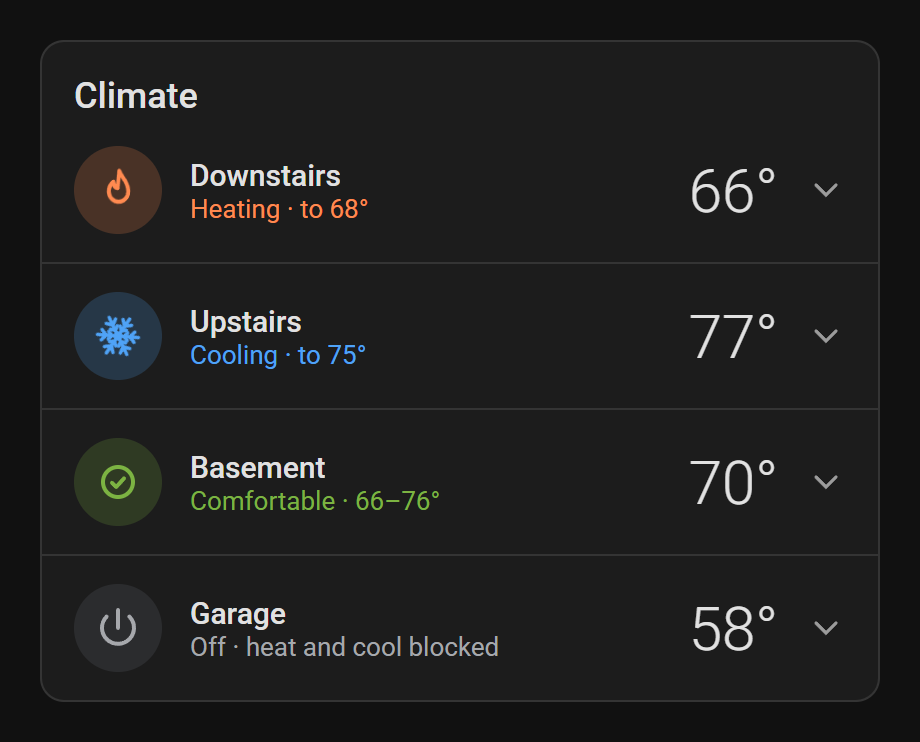
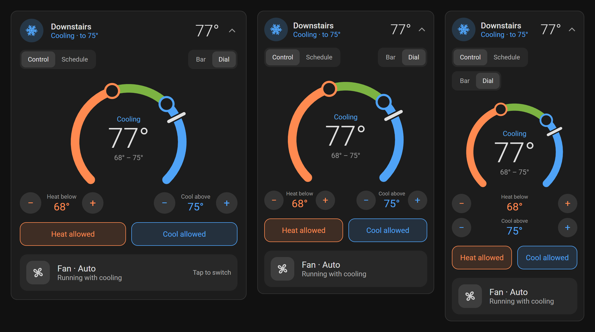
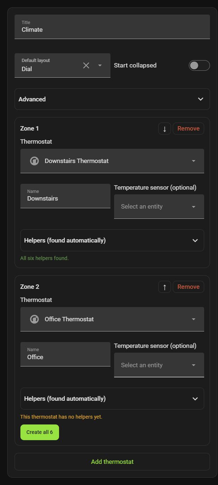

# Temperate

A thermostat card and automation blueprint for Home Assistant.

Set a range, for example 68° to 75°. The automation writes both numbers to the thermostat as its heat and cool setpoints and switches the mode: heat when the room drops below 68°, cool when it rises above 75°. The thermostat regulates the temperature itself, with its own cycling and short-cycle protection. Changes made at the thermostat are left alone until you switch back to auto.

<p align="center">
  <picture>
    <source media="(prefers-color-scheme: light)" srcset="docs/images/hero-light.png">
    
  </picture>
</p>

## Features

- One comfort range per thermostat. Heat and cool switch automatically.
- Heat and Cool buttons allow or block each mode. Blocking cooling in winter keeps it off.
- Changes made on the thermostat are detected and kept. The card shows a Manual banner with a Back to auto button.
- Bar or dial layout, chosen per thermostat. Drag the handles or use the + and − buttons.
- A 24-hour schedule per thermostat. Each period has its own range or turns the thermostat off.
- Each thermostat collapses to a single row showing the room temperature and current state.
- Works in narrow dashboard columns and on phones.
- Visual editor, which can also create the helpers each thermostat needs.

## Screenshots

Manual mode, after someone set the heat to 73° on the thermostat:

<p align="center">
  
</p>

Bar and dial layouts:

<p align="center">
  
</p>

The Schedule tab. Green is the comfort range, and gray is a period with the thermostat off:

<p align="center">
  
</p>

Collapsed rows:

<p align="center">
  
</p>

The same card in a wide column, a narrow column and at phone width. At the smallest size the heat and cool controls stack:

<p align="center">
  
</p>

The editor. The second thermostat has no helpers yet:

<p align="center">
  
</p>

## How the automation works

Every thermostat has a *heat below* and a *cool above* number, stored in Home Assistant helpers. The automation copies them to the thermostat's `target_temp_low` and `target_temp_high` setpoints. It does not switch the heating or cooling on and off itself. The thermostat holds the active setpoint the way it normally would.

The automation only chooses the mode:

- Room below *heat below* and heat allowed: heat.
- Room above *cool above* and cooling allowed: cool.
- Otherwise the mode stays as it is, as long as that mode is still allowed. If it isn't, heat is used if allowed, then cool.
- Neither mode allowed: off.

Between the two numbers the mode does not change, so the range also acts as a deadband between heating and cooling. The card keeps the numbers at least `min_gap` apart.

The automation runs whenever the room temperature, the range or the allow buttons change, and every five minutes.

### Turning the thermostat on and off

The automation turns the thermostat off only when heat and cooling are both disallowed. It turns it back on, in heat or cool, when one of them is allowed again. While the room is inside the range the thermostat stays in heat or cool and idles at its setpoint.

It only acts when the thermostat is in `off`, `heat`, `cool` or `emergency_heating`. In any other mode (`auto`, `heat_cool`, `dry`, `fan_only`) the automation does nothing, with one exception: Back to auto moves the thermostat to heat, cool or off according to the rules above.

### Manual override

A manual change is any change to the thermostat's mode or setpoints that the automation did not make. This includes the thermostat's own buttons, an IR or wall remote, the standard Home Assistant thermostat card, and other automations. If the difference lasts longer than the settle time (20 seconds by default), the automation turns on the manual override and stops sending commands.

The override stays on until it is turned off with Back to auto on the card, or by turning off the `manual_override` helper. The automation then writes the range back to the thermostat.

Example: the range is 14° to 24° and someone sets 20° on the remote. The thermostat stays at 20° and the card shows the Manual banner. After Back to auto, the setpoints return to 14° and 24°.

The settle time is there because some thermostats confirm commands slowly. It can be changed in the automation.

## Schedule

The Schedule tab divides the day into periods. Each period has a start time and either a range or Off, and runs until the next period starts. The same day repeats all week. Drag a handle on the ribbon to move a start time, or select a period to edit it.

To set one up:

1. Open the Schedule tab and select **Create schedule**. This creates `schedule.<name>_schedule` and `input_boolean.<name>_follow_schedule`. An admin account is required.
2. Edit the automation for that thermostat and choose those two helpers under **Schedule** and **Follow schedule**.

The periods are stored in the schedule helper, so the schedule runs without the dashboard open. Until the automation is linked to the schedule, the card shows the range as held and periods do not change it.

| Situation | Behavior |
|---|---|
| A period starts | Its range is written to *heat below* and *cool above*. |
| An Off period is active | The thermostat is off. Heat allowed and Cool allowed are not changed. |
| The range is changed during a period | The new range holds until the next period. Resume on the card ends it early. |
| Manual override is on | The override stays on. Back to auto restores the current period. |
| Follow schedule is off | The range stays as set, and the schedule is ignored. |

### Limiting heating and cooling to certain hours

An Off period on the Schedule tab does this. To control it from your own automation instead, use the allow toggles.

*Heat allowed* and *cool allowed* are ordinary `input_boolean` helpers, so any automation can switch them. With both off, the thermostat is turned off. For example, with a [schedule helper](https://www.home-assistant.io/integrations/schedule/) named `schedule.downstairs_climate_hours`:

```yaml
alias: Downstairs climate hours
triggers:
  - trigger: state
    entity_id: schedule.downstairs_climate_hours
    to:
      - "on"
      - "off"
actions:
  - action: "input_boolean.turn_{{ trigger.to_state.state }}"
    target:
      entity_id:
        - input_boolean.downstairs_heat_allowed
        - input_boolean.downstairs_cool_allowed
```

This turns both toggles on each time the window opens, which clears a block set by hand. To keep cooling blocked for a season, remove that toggle from the automation.

## Requirements

- Home Assistant 2024.10 or later. The Schedule tab requires 2025.3 or later.
- A `climate` entity with `heat` and `cool` modes that reports separate heat and cool setpoints (`target_temp_low` and `target_temp_high`) in both heat and cool modes. Entities that report them only in `heat_cool` mode can be switched between modes, but the range is not written to them. Thermostats and air conditioners with a single `temperature` setpoint are not supported yet.

°C and °F are both supported. The card follows the unit system set in Home Assistant and picks matching defaults for the dial scale, step and gap.

## Installation

The card, helpers and blueprint can all be installed from the Home Assistant UI, without copying files into the config folder.

### Card

In the Home Assistant Marketplace (HACS on versions before 2026.11), search for **Temperate** and download it.

If it isn't listed yet, add this repository as a custom repository of type **Dashboard**, then download **Temperate**.

Manual: copy `temperate-card.js` to `config/www/temperate-card/` and add a dashboard resource:

```yaml
url: /local/temperate-card/temperate-card.js
type: module
```

### Helpers

Add the card to a dashboard and select your thermostats. The editor lists any missing helpers under each thermostat, with a button to create them. New helpers take their range from the thermostat's current setpoints. Creating helpers requires an admin account.

To create them yourself instead, see [Helpers](#helpers-1).

### Blueprint

[](https://my.home-assistant.io/redirect/blueprint_import/?blueprint_url=https%3A%2F%2Fgithub.com%2Fxman2000%2Ftemperate-card%2Fblob%2Fmain%2Fblueprints%2Ftemperate_changeover.yaml)

Or import this URL under **Settings → Automations & scenes → Blueprints**:

```
https://github.com/xman2000/temperate-card/blob/main/blueprints/temperate_changeover.yaml
```

Create one automation per thermostat from **Temperate changeover**.

The Marketplace updates the card only. To get a new version of the blueprint, open it under **Settings → Automations & scenes → Blueprints** and select **Re-import blueprint**. Existing automations pick up the new version.

## Helpers

Six per thermostat. The card looks them up by name, using the thermostat's entity id without `climate.` and without a trailing `_thermostat` as a prefix. For `climate.downstairs_thermostat`:

| Entity | Type | Purpose |
|---|---|---|
| `input_boolean.downstairs_heat_allowed` | Toggle | Heat allowed |
| `input_boolean.downstairs_cool_allowed` | Toggle | Cooling allowed |
| `input_boolean.downstairs_manual_override` | Toggle | Manual override is on |
| `input_number.downstairs_heat_below` | Number | Low end of the range |
| `input_number.downstairs_cool_above` | Number | High end of the range |
| `input_text.downstairs_commanded_mode` | Text | Last mode the automation set |

As a package:

```yaml
# config/packages/temperate_downstairs.yaml
input_boolean:
  downstairs_heat_allowed:
    name: Downstairs heat allowed
  downstairs_cool_allowed:
    name: Downstairs cool allowed
  downstairs_manual_override:
    name: Downstairs manual override
input_number:
  downstairs_heat_below:
    name: Downstairs heat below
    min: 45
    max: 86
    step: 1
    unit_of_measurement: °F
  downstairs_cool_above:
    name: Downstairs cool above
    min: 45
    max: 86
    step: 1
    unit_of_measurement: °F
input_text:
  downstairs_commanded_mode:
    name: Downstairs commanded mode
```

For °C, use a range of about 7–30 with a step of 0.5. Helpers with other names can be selected in the card editor.

## Configuration

```yaml
type: custom:temperate-card
title: Climate
layout: dial
collapsed: false
entities:
  - entity: climate.downstairs_thermostat
    name: Downstairs
  - entity: climate.upstairs_thermostat
    name: Upstairs
    temperature_sensor: sensor.bedroom_temperature
```

| Option | Default | Description |
|---|---|---|
| `entity` / `entities` | | One thermostat or a list. Entries can be entity ids or objects. |
| `title` | | Card title |
| `layout` | `bar` | `bar` or `dial`. Each browser remembers the last layout used. |
| `collapsed` | `false` | Start with thermostats collapsed |
| `min_gap` | 2 °F / 1 °C | Minimum gap between heat and cool |
| `dial_min`, `dial_max` | 55–85 °F / 13–29 °C | Scale of the bar and dial |

Per thermostat:

| Option | Description |
|---|---|
| `entity` | Climate entity |
| `name` | Display name. Defaults to the entity name. |
| `temperature_sensor` | Sensor to show in place of the thermostat's own reading |
| `heat_allowed`, `cool_allowed`, `manual_override`, `heat_below`, `cool_above`, `commanded_mode`, `schedule`, `follow_schedule` | Helper to use in place of the default name |

## Theming

| Variable | Default |
|---|---|
| `--temperate-heat` | `#FF8A50` |
| `--temperate-cool` | `#4FA3F7` |
| `--temperate-ok` | `#7CB342` |
| `--temperate-off` | `#6B7078` |
| `--temperate-manual` | `#FFD54F` |
| `--temperate-marker` | `var(--primary-text-color)` |

## License

MIT
