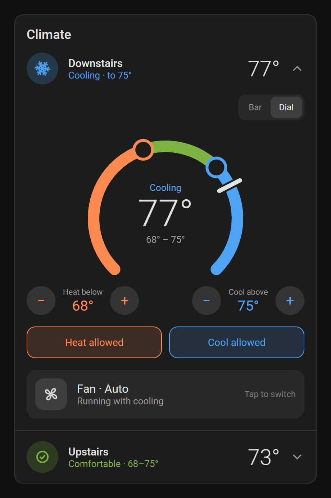
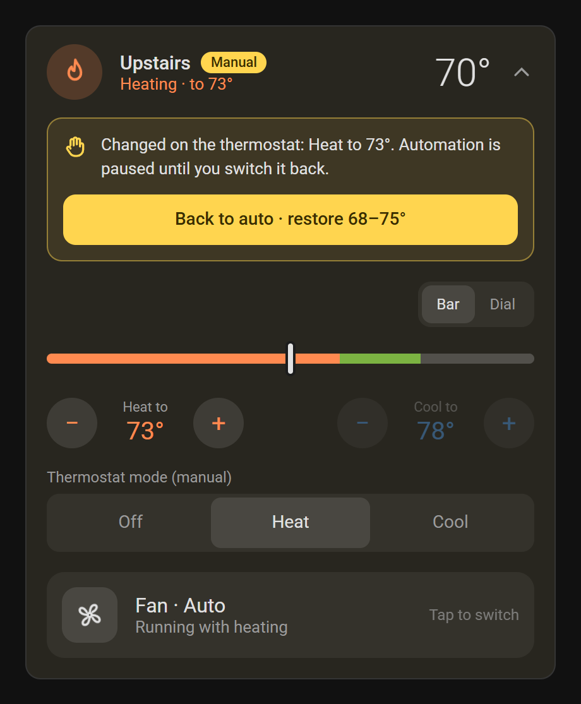
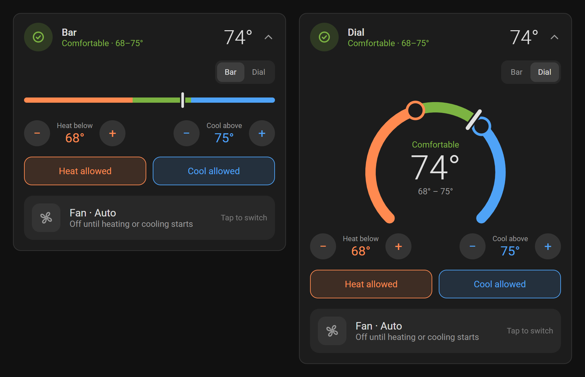
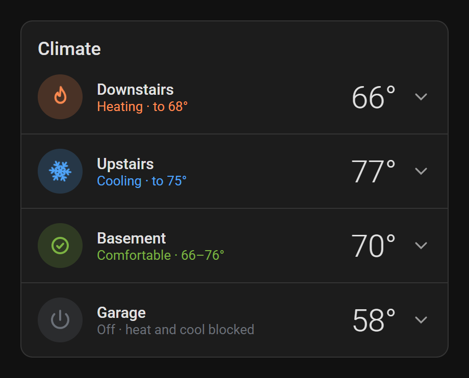
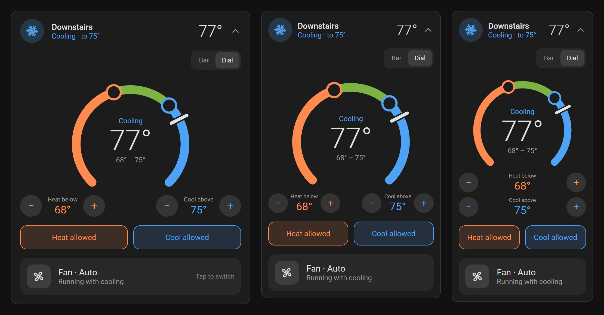
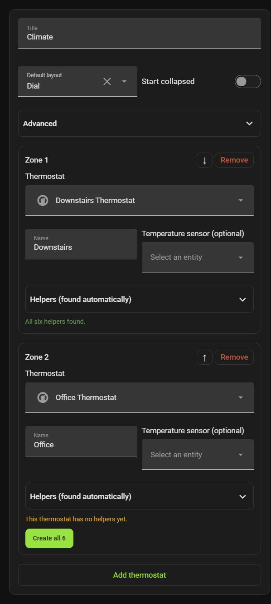

# Temperate

A thermostat card and automation blueprint for Home Assistant.

Set a range, for example 68° to 75°. Below 68° the thermostat heats. Above 75° it cools. In between it does nothing. Changes made at the thermostat itself are left alone until you switch back to auto.

<p align="center">
  <picture>
    <source media="(prefers-color-scheme: light)" srcset="docs/images/hero-light.png">
    
  </picture>
</p>

## Features

- One comfort range per thermostat. Heat and cool switch automatically.
- Heat and Cool buttons allow or block each mode. Blocking cooling in winter keeps it off.
- Changes made on the thermostat are detected and kept. The card shows a Manual banner with a Back to auto button.
- Bar or dial layout, chosen per thermostat. Drag the handles or use the + and − buttons.
- Each thermostat collapses to a single row showing the room temperature and current state.
- Works in narrow dashboard columns and on phones.
- Visual editor, which can also create the helpers each thermostat needs.

## Screenshots

Manual mode, after someone set the heat to 73° on the thermostat:

<p align="center">
  
</p>

Bar and dial layouts:

<p align="center">
  
</p>

Collapsed rows:

<p align="center">
  
</p>

The same card in a wide column, a narrow column and at phone width. At the smallest size the heat and cool controls stack:

<p align="center">
  
</p>

The editor. The second thermostat has no helpers yet:

<p align="center">
  
</p>

## How the automation decides

Every thermostat has a *heat below* and a *cool above* number, stored in Home Assistant helpers. The blueprint copies them to the thermostat's low and high setpoints and sets the mode:

- Room below *heat below* and heat allowed: heat.
- Room above *cool above* and cooling allowed: cool.
- Otherwise the mode stays as it is, as long as that mode is still allowed. If it isn't, heat is used if allowed, then cool.
- Neither mode allowed: off.

It runs whenever the room temperature, the range or the allow buttons change, and every five minutes.

If the thermostat's mode or setpoints stop matching what the automation last sent, and the difference lasts longer than 20 seconds, it counts as a manual change. The automation turns on the manual override and stops sending commands. Turning the override off (Back to auto on the card) puts the range back. The 20-second wait is there because some Zigbee thermostats confirm commands slowly. It can be changed in the automation.

## Requirements

- Home Assistant 2024.10 or later.
- A `climate` entity with `heat` and `cool` modes that supports `target_temp_low` and `target_temp_high`.

## Installation

### Card

HACS or the Home Assistant Marketplace: add this repository as a custom repository of type **Dashboard**, then download **Temperate**.

Manual: copy `temperate-card.js` to `config/www/temperate-card/` and add a dashboard resource:

```yaml
url: /local/temperate-card/temperate-card.js
type: module
```

### Helpers

Add the card to a dashboard and select your thermostats. The editor lists any missing helpers under each thermostat, with a button to create them. New helpers take their range from the thermostat's current setpoints. Creating helpers requires an admin account.

To create them yourself instead, see [Helpers](#helpers-1).

### Blueprint

[](https://my.home-assistant.io/redirect/blueprint_import/?blueprint_url=https%3A%2F%2Fgithub.com%2Fxman2000%2Ftemperate-card%2Fblob%2Fmain%2Fblueprints%2Ftemperate_changeover.yaml)

Or import this URL under **Settings → Automations & scenes → Blueprints**:

```
https://github.com/xman2000/temperate-card/blob/main/blueprints/temperate_changeover.yaml
```

Create one automation per thermostat from **Temperate changeover**.

## Helpers

Six per thermostat. The card looks them up by name, using the thermostat's entity id without `climate.` and without a trailing `_thermostat` as a prefix. For `climate.downstairs_thermostat`:

| Entity | Type | Purpose |
|---|---|---|
| `input_boolean.downstairs_heat_allowed` | Toggle | Heat allowed |
| `input_boolean.downstairs_cool_allowed` | Toggle | Cooling allowed |
| `input_boolean.downstairs_manual_override` | Toggle | Manual override is on |
| `input_number.downstairs_heat_below` | Number | Low end of the range |
| `input_number.downstairs_cool_above` | Number | High end of the range |
| `input_text.downstairs_commanded_mode` | Text | Last mode the automation set |

As a package:

```yaml
# config/packages/temperate_downstairs.yaml
input_boolean:
  downstairs_heat_allowed:
    name: Downstairs heat allowed
  downstairs_cool_allowed:
    name: Downstairs cool allowed
  downstairs_manual_override:
    name: Downstairs manual override
input_number:
  downstairs_heat_below:
    name: Downstairs heat below
    min: 45
    max: 86
    step: 1
    unit_of_measurement: °F
  downstairs_cool_above:
    name: Downstairs cool above
    min: 45
    max: 86
    step: 1
    unit_of_measurement: °F
input_text:
  downstairs_commanded_mode:
    name: Downstairs commanded mode
```

For °C, use a range of about 7–30 with a step of 0.5. Helpers with other names can be selected in the card editor.

## Configuration

```yaml
type: custom:temperate-card
title: Climate
layout: dial
collapsed: false
entities:
  - entity: climate.downstairs_thermostat
    name: Downstairs
  - entity: climate.upstairs_thermostat
    name: Upstairs
    temperature_sensor: sensor.bedroom_temperature
```

| Option | Default | Description |
|---|---|---|
| `entity` / `entities` | | One thermostat or a list. Entries can be entity ids or objects. |
| `title` | | Card title |
| `layout` | `bar` | `bar` or `dial`. Each browser remembers the last layout used. |
| `collapsed` | `false` | Start with thermostats collapsed |
| `min_gap` | 2 °F / 1 °C | Minimum gap between heat and cool |
| `dial_min`, `dial_max` | 55–85 °F / 13–29 °C | Scale of the bar and dial |

Per thermostat:

| Option | Description |
|---|---|
| `entity` | Climate entity |
| `name` | Display name. Defaults to the entity name. |
| `temperature_sensor` | Sensor to show in place of the thermostat's own reading |
| `heat_allowed`, `cool_allowed`, `manual_override`, `heat_below`, `cool_above` | Helper to use in place of the default name |

## Theming

| Variable | Default |
|---|---|
| `--temperate-heat` | `#FF8A50` |
| `--temperate-cool` | `#4FA3F7` |
| `--temperate-ok` | `#7CB342` |
| `--temperate-off` | `#6B7078` |
| `--temperate-manual` | `#FFD54F` |
| `--temperate-marker` | `var(--primary-text-color)` |

## License

MIT
